<h1 align="center">Agent Memory</h1>

<p align="center">
  <em>Long-term memory for AI agents: episodic, semantic, and procedural memory in SQLite, a write path that extracts and versions facts, a hybrid retriever that explains every result, a consolidation job that summarizes and forgets, and a Model Context Protocol server so it plugs into Claude Desktop or VS Code.</em>
</p>

<p align="center">
  <a href="https://github.com/adeoluo/agent-memory/actions/workflows/ci.yml"></a>
  <a href="https://github.com/adeoluo/agent-memory/releases"></a>
  
  <a href="LICENSE"></a>
</p>

---

## Motivation

A language model forgets everything when its context window ends. Stuffing the whole history back
into the prompt stops working after a few sessions, and naive "store every message, search by
similarity" memory returns stale answers: if a user said "my favorite editor is Vim" in March and
"I switched to Neovim" in June, both statements match the question equally well.

This project is a **usable memory tool** that treats those problems directly:

- **What to store.** Turns are kept as timestamped episodes, and durable facts are extracted from
  them into versioned (subject, predicate, object) triples with confidence, so "current value"
  is a property of the store rather than something the model has to infer from raw text.
- **How to update.** New evidence is deduplicated against what is already known, conflicts are
  resolved by recency and confidence, and superseded values are kept as history so questions
  about the past still work.
- **How to retrieve.** One documented scoring function combines BM25, embedding similarity,
  recency, and importance, and every result says why it was retrieved.
- **How to stay small.** A consolidation job summarizes old sessions into semantic memory and
  forgets raw episodes by exponential decay, which keeps storage and latency flat as sessions grow.

It ships as a Python library, a command-line tool, and an MCP server, and it comes with a
benchmark harness that reports real numbers for memory against no memory and a truncated context
window, plus an ablation of every scoring term.

## Architecture

<p align="center">
  
</p>

<sub>Legend: amber = entry points and external systems, indigo = core logic, green = data and state, blue = validation and control, grey = observability and outputs.</sub>

Every row carries a namespace (one per user or agent) and every query filters on it. The MCP
server and CLI both call the `AgentMemory` facade. A turn is embedded and stored as an episode, and
the extractor (rules by default, an LLM if configured) proposes facts that the merger reinforces,
adds, supersedes, or marks contested in semantic and procedural memory. Queries are answered by a
hybrid scorer over FTS5 and vector candidates that returns each memory with its score breakdown. A
consolidation pass summarizes old sessions into facts and forgets low-retention episodes and stale
history, and the benchmark harness drives the same API to produce the published results.
[docs/ARCHITECTURE.md](docs/ARCHITECTURE.md) covers the modules, schema, and data flow; the design
decisions are recorded as [ADRs](docs/adr/).

## Results

> Reproduce with `make evaluation` (or `uv run python benchmarks/run_benchmark.py`). Full tables
> are in [`benchmarks/results.md`](benchmarks/results.md) and raw numbers in
> [`benchmarks/results.json`](benchmarks/results.json). Accuracy and recall are deterministic per
> seed; latency was measured on an Apple silicon laptop and will vary.

**Setup.** A deterministic synthetic dataset ([data card](docs/DATA_CARD.md)): 12 users x 20
sessions per seed (about 2,940 turns), each user with six topic preferences, a home city, and an
employer that change over time, plus distractors (other people's preferences, questions that name
candidate values, tentative plans) and small talk. Questions ask for the **current** value (must
reflect every update) or the value **before the most recent change** (needs history); 40% of topic
questions use a paraphrase ("coding language" for "programming language"). Test seeds 7, 8, 9
(about 155 questions each); mean ± standard deviation across seeds. Every condition feeds the same
deterministic reader, which is told the attribute being asked about, orders the statements it can
see by time, and answers; differences come only from what each memory condition shows it.

### Memory versus no memory and context truncation

| Condition | Accuracy | Current | Previous | Paraphrased | Recall@1 | Recall@5 |
|---|---|---|---|---|---|---|
| (a) No memory (uniform guess among the attribute's values) | 0.172 ± 0.012 | 0.184 | 0.150 | 0.179 | n/a | n/a |
| (b) Full-context truncation, last 400 words | 0.114 ± 0.010 | 0.181 | 0.005 | 0.130 | n/a | n/a |
| (b) Full-context truncation, last 1,600 words | 0.573 ± 0.013 | 0.670 | 0.416 | 0.616 | n/a | n/a |
| (c) Lexical only (BM25), full store | 0.974 ± 0.030 | 0.969 | 0.983 | 0.916 | 0.589 | 0.974 |
| (d) **Full hybrid (shipped default weights)** | **0.957 ± 0.014** | 0.976 | 0.929 | 0.855 | 0.584 | 0.957 |
| (d) Full hybrid, episodes only (no fact extraction) | 0.597 ± 0.030 | 0.656 | 0.502 | 0.392 | 0.294 | 0.659 |
| Hybrid with weights tuned on held-out development seeds 101, 102 | 0.981 ± 0.018 | 0.979 | 0.983 | 0.936 | 0.526 | 0.981 |

Recall@k is the share of questions with at least one of the top `k` memories stating the gold
value; the reader answers from the top 5. For "previous" questions the current value usually ranks
first, so recall@1 is low by construction.

### Ablation of each scoring term

| Removed term | Full store accuracy | Full store recall@1 | Episodes-only accuracy | Episodes-only recall@5 |
|---|---|---|---|---|
| none (full hybrid) | 0.957 ± 0.014 | 0.584 | 0.597 ± 0.030 | 0.659 |
| lexical | 0.860 ± 0.023 | 0.374 | 0.344 ± 0.045 | 0.413 |
| semantic | 0.972 ± 0.019 | 0.567 | 0.573 ± 0.012 | 0.631 |
| recency | 0.961 ± 0.007 | 0.664 | 0.635 ± 0.011 | 0.713 |
| importance | 0.957 ± 0.021 | 0.578 | 0.576 ± 0.022 | 0.640 |

### Latency and storage versus number of sessions

Three users; with consolidation, the job runs every 10 sessions and once at the end
(summarize sessions older than 7 days, forget summarized episodes whose decayed retention falls
below 0.05 with a 30-day half-life).

| Sessions | Consolidation | Turns | Memories stored | Database (KB) | Ingest (ms/turn) | Recall p50 (ms) | Recall p95 (ms) | Accuracy |
|---|---|---|---|---|---|---|---|---|
| 50 | no | 1,714 | 1,760 | 2,772 | 0.07 | 1.06 | 1.54 | 0.950 |
| 50 | yes | 1,714 | 1,094 | 1,852 | 0.08 | 1.09 | 1.33 | 0.950 |
| 100 | no | 3,272 | 3,313 | 5,168 | 0.07 | 1.50 | 3.21 | 0.944 |
| 100 | yes | 3,272 | 1,157 | 2,036 | 0.07 | 1.32 | 1.84 | 0.917 |
| 200 | no | 6,556 | 6,601 | 10,212 | 0.07 | 2.10 | 9.77 | 0.949 |
| 200 | yes | 6,556 | 1,428 | 2,644 | 0.08 | 1.69 | 2.47 | 0.949 |

### What the numbers say (and do not say)

- **Structured memory is the main win.** Extracting and versioning facts lifts accuracy from 0.597
  (hybrid retrieval over raw episodes) to 0.957, and every retrieval condition beats a 1,600-word
  context window (0.573), which loses facts stated in early sessions and almost never has the
  history needed for "previous" questions.
- **On this dataset lexical retrieval alone is as good as the hybrid.** BM25 only (0.974) is within
  noise of, and nominally above, the default hybrid (0.957). The synthetic questions share
  vocabulary with the statements, which favors BM25. Removing the semantic or recency term
  slightly *raises* full-store accuracy; the paraphrase failures that remain are true synonyms
  ("food" for "cuisine") that a hashing embedder cannot bridge.
- **The other terms help where lexical evidence is weak.** On the episodes-only store the semantic
  term adds 2.4 points and importance adds 2.1. Recency hurts in both stores: currentness is
  already handled by supersession, and a recency prior pushes stable facts stated early below
  recent distractors.
- **Tuning confirms it and is reported separately.** A grid search on development seeds disjoint
  from the test seeds selects `lexical=0.15, importance=0.15, semantic=0, recency=0` (0.981 on the
  test seeds). The shipped defaults stay at the a priori weights because real conversations
  paraphrase far more than this generator, which is exactly where `S` should matter, ideally with
  a neural embedder. Pass `ScoringWeights(...)` to choose otherwise.
- **Consolidation bounds growth.** At 200 sessions it stores 78% fewer memories, uses 74% less
  disk, and cuts p95 recall latency from 9.8 ms to 2.5 ms at equal accuracy. At 100 sessions it
  costs one of 36 questions (2.7 points): a paraphrased question ("physical activity" for "sport")
  whose fact ranked fifth in both stores on the shared word "preferred"; deleting episodes changed
  the BM25 corpus statistics and pushed it to sixth. No fact was lost.
- **Scope.** The data is synthetic and its phrasings overlap with the rule extractor's patterns, so
  extraction is close to perfect here; real conversations would stress the extractor (the
  `LLMExtractor` path exists for that). The reader is a deterministic oracle-parsed reader, not a
  language model. These results compare conditions inside one controlled setup; they are not a
  comparison against other memory products such as Mem0, Zep, or Letta, which have not been
  benchmarked here.

## Quickstart

```bash
# As a command-line tool, straight from GitHub
uv tool install git+https://github.com/adeoluo/agent-memory

# Or the wheel attached to the latest release
pip install https://github.com/adeoluo/agent-memory/releases/download/v0.1.0/agent_memory-0.1.0-py3-none-any.whl
```

Python 3.11 or newer. Runtime dependencies: `numpy` and the official `mcp` Python SDK.

Store two turns and ask a question:

```console
$ agent-memory add "My favorite editor is Vim."
$ agent-memory add "Actually, I switched to Neovim for my editor."
$ agent-memory recall "which editor does the user prefer?" -k 1
1. [semantic #4] user preference for editor is Neovim
```

## Usage

### Command line

```console
$ agent-memory add "My favorite editor is Vim. I live in Lisbon."
stored episode 1
  added fact 2
  added fact 3
$ agent-memory add "Actually, I switched to Neovim for my editor."
stored episode 4
  fact 5 superseded fact 2
$ agent-memory recall "which editor does the user prefer?" -k 2
1. [semantic #5] user preference for editor is Neovim
   score 0.830: semantic fact (active, confidence 0.95); lexical match on 'editor', 'user', 'prefer' (BM25 1.00 of best); embedding similarity 0.55; observed 0.0 days ago (recency 1.00); importance 0.76; largest contribution: lexical (0.40)
2. [episodic #1] My favorite editor is Vim. I live in Lisbon.
   score 0.352: episodic memory; lexical match on 'editor' ...
$ agent-memory facts --history
#2 [superseded, 0.90] user preference for editor is Vim
#3 [active, 0.90] user lives in Lisbon
#5 [active, 0.95] user preference for editor is Neovim
$ agent-memory consolidate
$ agent-memory stats
```

Other commands: `facts`, `forget <id>`, `export <file>`, `import <file>`, `mcp`, and `benchmark`.
`--database` (default `~/.agent-memory/memory.db`) and `--namespace` (default `default`) select
the store; both can also be set with `AGENT_MEMORY_DATABASE` and `AGENT_MEMORY_NAMESPACE`.

### Python API

```python
from agent_memory import AgentMemory, ScoringWeights

memory = AgentMemory("memory.db", namespace="alice")
memory.add_turn("My favorite drink is black coffee.", session_id="monday")
memory.add_turn("These days my favorite drink is matcha.", session_id="friday")

for hit in memory.recall("what does alice like to drink?", k=3):
    print(f"{hit.score.total:.2f}", hit.text, "|", hit.explanation)

memory.current_fact("user", "prefers:drink").object  # 'matcha'
[f.object for f in memory.fact_history("user", "prefers:drink")]  # ['black coffee', 'matcha']

memory.set_preference("response_style", "short answers")
memory.consolidate()  # summarize old sessions, forget decayed episodes
memory.export_to("alice.json")  # portable JSON, re-importable into any namespace
bob = memory.for_namespace("bob")  # same database, strictly isolated namespace
```

Extraction is pluggable. `RuleExtractor` is the deterministic default; `LLMExtractor` sends the
turn to any `Provider` and parses a JSON reply. Tests use the offline `FakeProvider`;
`AnthropicProvider` calls Claude when `ANTHROPIC_API_KEY` is set.

```python
from agent_memory import AgentMemory, AnthropicProvider, LLMExtractor

memory = AgentMemory("memory.db", namespace="alice", extractor=LLMExtractor(AnthropicProvider()))
```

### MCP server (Claude Desktop, VS Code)

`agent-memory mcp` serves one namespace over standard input and output with four tools:
`remember`, `recall`, `forget`, and `list_facts`. The namespace is fixed when the server starts, so
the connected model cannot read or delete another namespace's memories.

Claude Desktop (`claude_desktop_config.json`):

```json
{
  "mcpServers": {
    "memory": {
      "command": "uvx",
      "args": ["--from", "git+https://github.com/adeoluo/agent-memory",
               "agent-memory", "--namespace", "me", "mcp"]
    }
  }
}
```

VS Code (`.vscode/mcp.json`), after `uv tool install`:

```json
{
  "servers": {
    "agent-memory": { "type": "stdio", "command": "agent-memory", "args": ["--namespace", "me", "mcp"] }
  }
}
```

### Memory kinds

| Memory kind | What it holds | Example |
|---|---|---|
| **Episodic** | Timestamped turns and events, grouped by session | `"Actually, I switched to Neovim for my editor."` at 2026-06-02 10:14 |
| **Semantic** | Facts as (subject, predicate, object) with confidence, evidence count, and status (`active`, `superseded`, `contested`) | `(user, prefers:editor, Neovim)`, confidence 0.95, supersedes `Vim` |
| **Procedural** | Key-value preferences and instructions with provenance | `response_style = bullet points`, "extracted from episode 8 (RuleExtractor)" |

### Retrieval score and configuration

For a query `q` and a candidate memory `m`, with every term in `[0, 1]`:

```
score(m, q) = 0.40 * L(m, q) + 0.30 * S(m, q) + 0.15 * R(m) + 0.15 * I(m)
```

| Term | Definition |
|---|---|
| `L` lexical | FTS5 BM25 of `m` for `q`, divided by the best BM25 among this query's candidates |
| `S` semantic | Cosine similarity of query and memory embeddings, clipped at 0 |
| `R` recency | `2 ** (-age / half_life)`, age since the evidence was last observed, half-life 30 days |
| `I` importance | Stored importance (higher for turns that state facts); for facts, times confidence |

Candidates come only from the channels with positive weight (FTS5 for `L`, the vector table for
`S`), so recency and importance re-rank relevant memories but never surface unrelated ones.
Superseded and contested facts are excluded unless the caller asks for history. Weights, half-life,
and candidate pool size are configurable through `MemorySettings`; see
[ADR-0003](docs/adr/0003-hybrid-scoring.md).

The built-in embedder is a deterministic feature-hashing embedder (word unigrams, bigrams, and
character trigrams into 256 signed buckets). It is **not** a neural sentence encoder: it captures
shared stems and spelling variants, not synonyms. Any object with `embed(text) -> numpy array`
can replace it.

## Design decisions

- [ADR-0002](docs/adr/0002-memory-model-and-storage.md): three memory kinds in one SQLite file
  with FTS5 and a vector table, namespace on every row.
- [ADR-0003](docs/adr/0003-hybrid-scoring.md): one additive, explainable scoring function.
- [ADR-0004](docs/adr/0004-fact-versioning.md): reinforce, add, supersede, or contest; never delete
  history on write.
- [ADR-0005](docs/adr/0005-consolidation-and-forgetting.md): summarize before forgetting, decay by
  importance and idle time.
- [ADR-0006](docs/adr/0006-mcp-namespace-binding.md): the MCP server is bound to one namespace.

## Testing

```bash
make setup      # dependencies and pre-commit hooks
make all        # ruff format check, ruff lint, mypy strict, pytest with the coverage gate
uv run pytest   # tests only
make evaluation # regenerate benchmarks/results.{json,md}
make build      # wheel and source distribution in dist/
```

The suite in `tests/` (83 tests, 98% line and branch coverage) covers:

- **Extraction:** every rule pattern, hedge and update confidence, distractors that must not be
  extracted, the LLM extractor through the offline `FakeProvider`, and malformed model replies.
- **Storage and isolation:** namespace validation, FTS5 query sanitization, and checks that
  lexical search, vector search, reads, status updates, access tracking, and deletes never cross
  namespaces; persistence of a file database.
- **Merging:** reinforcement, multi-valued predicates, supersession, contested weak evidence,
  out-of-order evidence, and preference history.
- **Scoring:** the recency formula, the weighted sum against the explanation, candidate channels,
  history and kind filters, and access tracking.
- **Consolidation:** retention decay and access boost, summaries, forgetting only summarized
  episodes, and optional pruning of fact history.
- **Interfaces:** the command line end to end, JSON export and import round trips, and the MCP
  server through an in-process MCP client, including a refused cross-namespace `forget`.
- **Evaluation:** dataset determinism and ground truth consistency, the reader, the benchmark
  ordering, and the requirement that tuning seeds are disjoint from test seeds.

Continuous integration runs ruff, mypy strict on `src` and `tests`, and pytest with a 90%
coverage gate on Python 3.11 and 3.12, then a benchmark smoke run, a wheel install smoke test,
and a Docker build. CodeQL runs on pushes and pull requests.

## Responsible AI

This project stores personal information and can evaluate and use language-model extraction,
so its behavior and risks are documented:

- [Model card](docs/MODEL_CARD.md) for the rule extractor, the LLM extractor, and the hashing
  embedder, including what they miss.
- [Data card](docs/DATA_CARD.md) for the synthetic benchmark and its biases.
- [Threat model](docs/THREAT_MODEL.md) for namespace isolation, query injection, stored prompt
  injection, and data sent to an optional provider.
- By default nothing leaves the machine. With `LLMExtractor` and a remote provider, each turn is
  sent to that provider. Users can export and delete their memories (`export`, `forget`).

## Limitations

- The rule extractor understands first-person statements in the phrasings its patterns cover. It
  will miss implicit or unusual phrasings; use `LLMExtractor` for open-ended text.
- The hashing embedder does not capture synonyms. Swap in a neural embedder for paraphrase-heavy
  workloads.
- Vector search is brute force over a namespace (one matrix product). That is fast to tens of
  thousands of memories per namespace, not millions.
- FTS5 BM25 statistics (document frequencies) are computed over the whole table, so the presence of
  other namespaces can shift scores slightly. Content never crosses namespaces; see the
  [threat model](docs/THREAT_MODEL.md).
- One writer at a time per database file (SQLite with write-ahead logging).

## Roadmap

- Optional neural embedder adapter and a paraphrase-heavy benchmark split.
- Query-type-aware weights (for example, no recency for questions about the past).
- An LLM reader in the benchmark, alongside the deterministic reader.
- Approximate nearest-neighbor index for very large namespaces.

## License

Released under the [MIT License](LICENSE).
