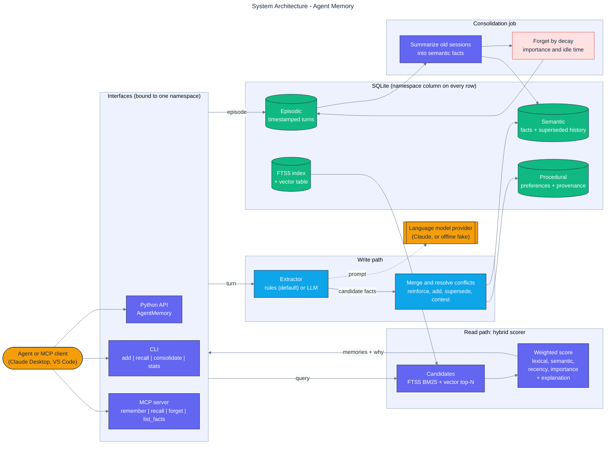
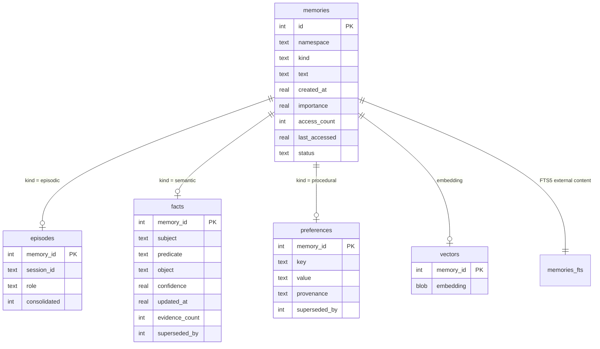
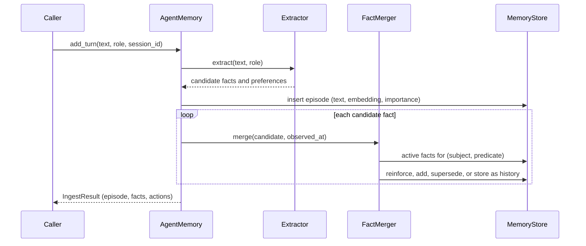

# Architecture

This document describes how Agent Memory is put together: the modules, the storage schema, the
write and read paths, consolidation, and the interfaces. Design rationale lives in the
[ADRs](adr/).

## System diagram

A rendered copy is in [architecture/architecture.svg](architecture/architecture.svg).

## Modules

| Module | Responsibility |
|---|---|
| `models.py` | Frozen dataclasses for `Episode`, `Fact`, `Preference`, `RetrievedMemory`, `ScoreBreakdown`, and reports |
| `settings.py` | `MemorySettings`, `ScoringWeights`, `ForgettingSettings` with documented defaults |
| `text.py` | Tokenization, stopwords, value normalization, sentence splitting |
| `embedding.py` | `Embedder` protocol and the feature-hashing `HashingEmbedder` (numpy) |
| `extraction.py` | `Extractor` protocol, `RuleExtractor`, `LLMExtractor`, JSON parsing of model replies |
| `provider.py` | `Provider` protocol and `AnthropicProvider` (Claude Messages API over HTTPS) |
| `fake_provider.py` | Offline deterministic `FakeProvider` used by tests |
| `store.py` | SQLite schema, FTS5 and vector search, namespace validation and filtering |
| `merge.py` | Fact and preference deduplication and conflict resolution |
| `scoring.py` | The hybrid score, candidate generation, and explanations |
| `consolidation.py` | Session summaries, retention, forgetting |
| `memory.py` | `AgentMemory`, the namespace-scoped facade used by every interface |
| `cli.py` | `agent-memory` command line |
| `mcp_server.py` | MCP server built on the official `mcp` SDK |
| `evaluation/` | Synthetic dataset generator and benchmark harness |

Dependencies point one way: interfaces depend on `memory.py`, which depends on the store,
merger, scorer, and consolidation functions, which depend only on models, settings, text, and
embedding. There are no import cycles.

## Storage schema

Triggers keep `memories_fts` in sync with `memories.text`; detail rows and vectors are removed by
`ON DELETE CASCADE`.

## Write path

## Read path

1. Build an FTS5 query from the content tokens of the question and take the top candidates by
   BM25 within the namespace and the requested statuses.
2. Embed the question and take the top candidates by cosine similarity from the namespace's
   vectors.
3. For the union, compute the four terms (lexical, semantic, recency, importance), the weighted
   total, the matched terms, and an explanation.
4. Sort by total, return the top `k`, and record the access (used by forgetting).

## Consolidation

A pass selects unconsolidated episodes older than the threshold, writes one extractive summary
fact per session, marks the episodes consolidated, and deletes consolidated episodes whose
decayed retention is below the threshold. See [ADR-0005](adr/0005-consolidation-and-forgetting.md).

## Interfaces

- **Python:** `AgentMemory` and the types exported from `agent_memory`.
- **Command line:** `agent-memory add | recall | consolidate | stats | facts | forget | export |
  import | mcp | benchmark`.
- **MCP:** `agent-memory mcp` over standard input and output, bound to one namespace, with the
  tools `remember`, `recall`, `forget`, and `list_facts`.
